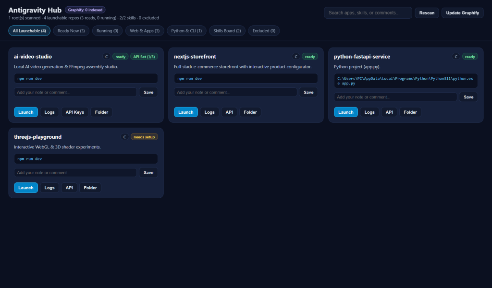
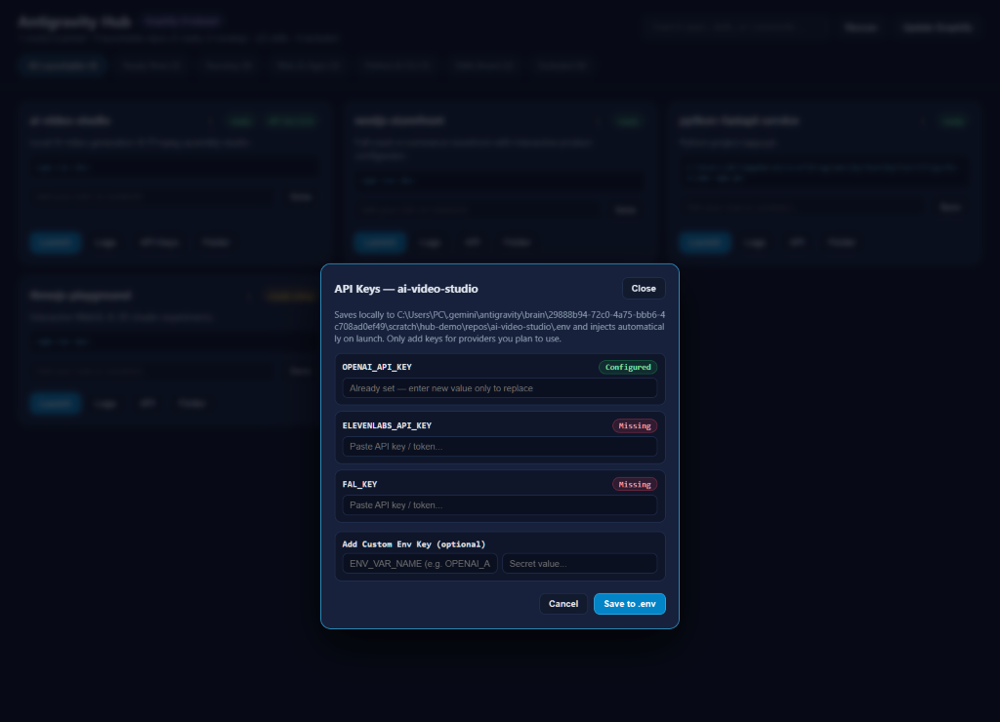

# Antigravity Hub

A lightweight, config-driven local dashboard to discover, annotate, launch, and monitor local repositories, apps, and agent skills — with optional [Graphify](https://github.com/JuliusBrussee/graphify) knowledge-graph integration.

## Screenshots

### Multi-Drive Workspace & API Status Dashboard


### Masked Pre-Launch `.env` API Key Setup


## Features

- **Automatic Multi-Drive Discovery (`"auto"`)**: Dynamically scans mounted drives on Windows (`C:`–`Z:`), macOS (`/Volumes/*`, `~`), and Linux (`/mnt`, `/media`, `~`) for common workspace folders (`Antigravity`, `Projects`, `Dev`, `Repos`, `Code`, `Work`) plus any custom `workspace_roots` in `hub.config.json` — skipping `node_modules` and `.venv`.
- **One-Click Launch & Stop**: Starts local servers internally, detects bound `http://localhost:<port>` URLs, opens the browser automatically, and tracks running PIDs so you can stop them cleanly.
- **Live Logs & Crash Detection**: Automatically surfaces stdout/stderr in the live log drawer if a command exits early.
- **API Key Status & Guided Pre-Launch Setup**: Detects required environment key names from `.env.example`, `.env`, or `SKILL.md` (strictly boolean status — never exposes secret values), lets you save missing keys locally to gitignored `.env`, and injects them cleanly before launch.
- **Skills Board**: Reads `SKILL.md` frontmatter from your skills folder and optionally toggles active symlinks/junctions from a master skill archive.
- **Persistent Notes**: Save per-project and per-skill notes locally in `comments.json` (gitignored).
- **Graphify Enrichment**: Reads `graphify-out/graph.json` to show connection counts and lets you run `graphify update .` from the UI.

## Quick Start

1. **Install Python dependencies**:
   ```bash
   pip install -r requirements.txt
   ```

2. **Create your local config** (gitignored):
   ```bash
   cp hub.config.example.json hub.config.json
   ```
   Edit `hub.config.json` to point `workspace_roots`, `skills_dir`, and any `custom_apps` to your own directories.

3. **Run the Hub**:
   - Windows: double-click `Launch_Hub.bat`
   - macOS / Linux: `./launch_hub.sh` (or `python3 server.py`)
   - Open `http://127.0.0.1:8787`

## Configuration (`hub.config.json`)

| Key | Description |
|---|---|
| `host`, `port` | Bind address and port (default `127.0.0.1:8787`) |
| `workspace_roots` | Array of directories to scan for repos/apps |
| `skills_dir` | Active agent skills folder (supports `~`) |
| `master_skills_dir` | Optional archive folder used to toggle active skill links |
| `graphify_json` | Optional path to `graphify-out/graph.json` |
| `excluded_names` | Folder names to move into the **Excluded** tab |
| `custom_apps` | Explicit app launch entries (`command`, `cwd`, `url`, `category`) |

## License

MIT
